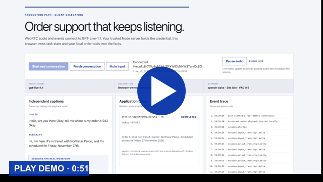

# GPT-Live-1.1 order-support demo

A real browser WebRTC + trusted Node integration for `gpt-live-1.1`, using client delegation and application-owned order tools. There is no simulated hosted mode, no browser API key, and no success UI without an observed API or tool result.

## Verified hosted evidence (22 Nov 2026)

The primary demo is a **51.267-second, 1920×1080, 30 fps browser recording with H.264 video and AAC stereo audio**. Click the preview to play **[GPT-Live-1.1 Demo: Real Order Support Call with Controlled Cancellation](https://youtu.be/UaZz3ft5sGg)** on YouTube.

<a href="https://youtu.be/UaZz3ft5sGg"></a>

The full architecture and implementation walkthrough is **[GPT-Live-1.1: Full-Duplex Voice Agents, WebRTC and Delegation](https://youtu.be/Gy611cJNbQE)** on the VIDEU channel. It includes seven caption tracks and six localized metadata sets.

The real hosted session shows order lookup for **A-1042**, a Monday delivery revision, a correction to Tuesday, cancellation before submission, and `session.closed` with **45 seconds of reported usage**. **No delivery change was recorded**. The final frame also exposes the **0:48 synchronized replay**, audio download, and event-log download. Session ID: `live_u1_En7Olp3oMbHq73iXWfDbNNWSYzrvOcSO`.

The repository also retains an earlier 68-second hosted recording and sanitized event samples as historical evidence. No API key is included.

## Live audio, recording, and synchronized replay

- During a call, Play/Pause controls only local assistant audio. Caller captions, assistant captions, tasks, and the event trace update as events arrive and never auto-scroll.
- The browser records a mixed microphone + assistant audio stream and timestamped snapshots of both captions, task state, and every trace entry. Recording starts with the call; the audio blob stores its offset relative to the first connection events.
- After `session.closed` (or an error), the app finalizes the recording and exposes **Play replay**, **Pause replay**, **Replay again**, and a millisecond-precision seek control.
- One replay clock drives audio and all three data views. Seeking restores the captions, tasks, and trace exactly as of that position; replay does not call tools or write server events.
- **Audio** downloads the recorded WebM/Opus or browser-supported MP4. **Event log** downloads the timestamped captions, tasks, and trace as JSON; audio is a separate download.
- Only the latest recording is kept in browser memory. Reloading or starting a new call discards it, so download anything you need to retain. The server does not receive or persist the audio, transcripts, or replay JSON.
- Autoplay failures, recording failures, remote-track silence, and replay errors are surfaced in the UI.
- The full suite contains 26 passing tests, including recording timestamps, mixed-source audio, replay pre-roll, pause/resume, seek, and browser playback failures.

## Requirements

- Node.js **22.6 or later**. The app uses only Node built-ins; there is no dependency install step.
- A current desktop browser with WebRTC and microphone support.
- For a real hosted call, an OpenAI **project API key with GPT-Live access** in `OPENAI_API_KEY`. This is mandatory: without it, `POST /api/session` returns HTTP 503. Do not put the key in any file under `public/`.
- Microphone permission. Open the app on loopback; use HTTPS before accessing it from another device.

## Run a real call

From the repository root:

```bash
cd presentation119/live-support-agent
export OPENAI_API_KEY='your-real-project-key'
node server.js
```

Then open **http://127.0.0.1:3000** and select **Start real conversation**. `npm start` is equivalent to `node server.js`. The server binds only to `127.0.0.1`.

The button requests the microphone, creates `oai-events` before the SDP offer, and sends the offer to the trusted server. The server alone reads `OPENAI_API_KEY` and posts this shape to `https://api.openai.com/v1/live/sessions`:

```json
{
  "session": {
    "model": "gpt-live-1.1",
    "delegation": { "type": "client", "acknowledgement_delay_ms": 800 },
    "wake_policy": { "type": "speech", "vad_threshold": 0.5 },
    "idle_timeout_s": 20
  },
  "transport": { "type": "webrtc", "sdp": "<browser offer>" }
}
```

The actual payload also includes the server-owned instructions, voice, and `store: false`; it omits `audio.format` and `audio.input`, which WebRTC negotiates. The browser applies the returned `transport.sdp` and waits for `session.started`. It never sends `session.start`.

Optional server-side session settings:

```bash
LIVE_IDLE_TIMEOUT_S=30 \
LIVE_VAD_THRESHOLD=0.6 \
LIVE_VOICE=marin \
PORT=3000 \
OPENAI_API_KEY='your-real-project-key' \
node server.js
```

`LIVE_IDLE_TIMEOUT_S` must be a whole number from 5 to 60. `LIVE_VAD_THRESHOLD` accepts 0 through 1. Standby keeps the microphone track, connection, and session ID intact; muting is not standby. The UI reports `session.paused` and `session.resumed` when observed.

## Exercise delegation

Try these spoken requests:

1. “Where is order A-1042?”
2. “Can it arrive Monday instead?”
3. “Yes, request the change.”

Before confirming, say “Actually, Tuesday” to revise the task, or “Cancel that” to cancel it. The browser saves input/output transcript deltas because `session.delegation.created` supplies metadata, not task text. It sends results with the original `delegation.id` through `session.commentary.append`. A silent `session.thinking.append` is sent immediately to suppress the pending automatic acknowledgment.

The included client backend is a deterministic order workflow, not a hosted-model imitation. It supports order lookup, future weekday/ISO-date delivery requests, explicit confirmation, revision, and cancellation. A revision aborts stale local work and suppresses its result. An in-flight write uses an idempotency operation ID and is cancelled on the server before replacement work proceeds; if cancellation cannot be verified, the UI reports that fact rather than claiming success.

## Real local tools and records

`data/orders.json` is the local JSON datastore. The trusted server exposes:

- `POST /api/tools/orders.lookup` with `{ "orderId": "A-1042" }`.
- `POST /api/tools/orders.change-request` with `{ "orderId": "A-1042", "requestedDate": "2026-11-23", "confirmed": true, "operationId": "unique-operation" }`.
- `POST /api/tools/orders.change-request/cancel` with `{ "operationId": "unique-operation", "orderId": "A-1042" }`.

All API POST routes require a same-origin `Origin` header. The browser supplies it automatically. For example, a local lookup from another terminal is:

```bash
curl --fail-with-body http://127.0.0.1:3000/api/tools/orders.lookup \
  -H 'Origin: http://127.0.0.1:3000' \
  -H 'Content-Type: application/json' \
  --data '{"orderId":"A-1042"}'
```

Change requests require `confirmed: true`, a future date, and an operation ID. Repeating the same operation returns the existing record instead of duplicating it. Cancellation updates the stored request or leaves a tombstone that blocks a late aborted request. Writes use a serialized queue and atomic file replacement. A request records `status: "requested"`; it deliberately does **not** change the order's scheduled delivery date or imply carrier confirmation.

Server and browser lifecycle/tool metadata is appended to `var/events.jsonl` (git-ignored). SDP, transcripts, tool result payloads, and credentials are not written there. Session creation, tool calls, delegation revisions/cancellations, standby transitions, close requests, and finalization outcomes are recorded.

## Graceful close

**Finish conversation** first cancels application-owned work, then sends `session.close`. The peer connection, data channel, and microphone stay alive while final events drain. Only `session.closed` confirms finalization and final usage; cleanup follows that event. If the channel fails or the 15-second close timeout expires first, the UI releases resources and explicitly reports unconfirmed finalization.

## Automated tests

No credential is needed. Tests never contact OpenAI: a loopback contract server verifies the hosted request shape and returns a deterministic SDP answer.

```bash
cd presentation119/live-support-agent
node --test
```

`npm test` runs the same command. Coverage includes the official session payload and 201 response, credential and origin boundaries, static client delivery, persistent tool behavior, confirmation/idempotency/cancellation, transcript-derived client delegation, original delegation IDs, barge-in revision, stale-result suppression, `oai-events` ordering, standby media behavior, `session.close`/`session.closed`, close-timeout teardown, mixed-source recording, timestamped event snapshots, and synchronized replay with pause, resume, and seek.

## Production boundary

This is the production API path with a deliberately small support backend. Before exposing it beyond loopback, add user authentication and authorization, HTTPS, CSRF/origin policy appropriate to the deployment, rate limits, retention controls, backup/recovery, and your organization's order-permission checks. Keep business records and tool permissions on the server.

The automated run verifies local contracts only. It does not claim a completed hosted GPT-Live call.

Official protocol sources:

- https://developers.openai.com/api/docs/guides/voice-webrtc?api=live
- https://developers.openai.com/api/docs/guides/live-delegation
- https://developers.openai.com/api/docs/guides/live-conversations
- https://developers.openai.com/api/docs/guides/live-prompting
